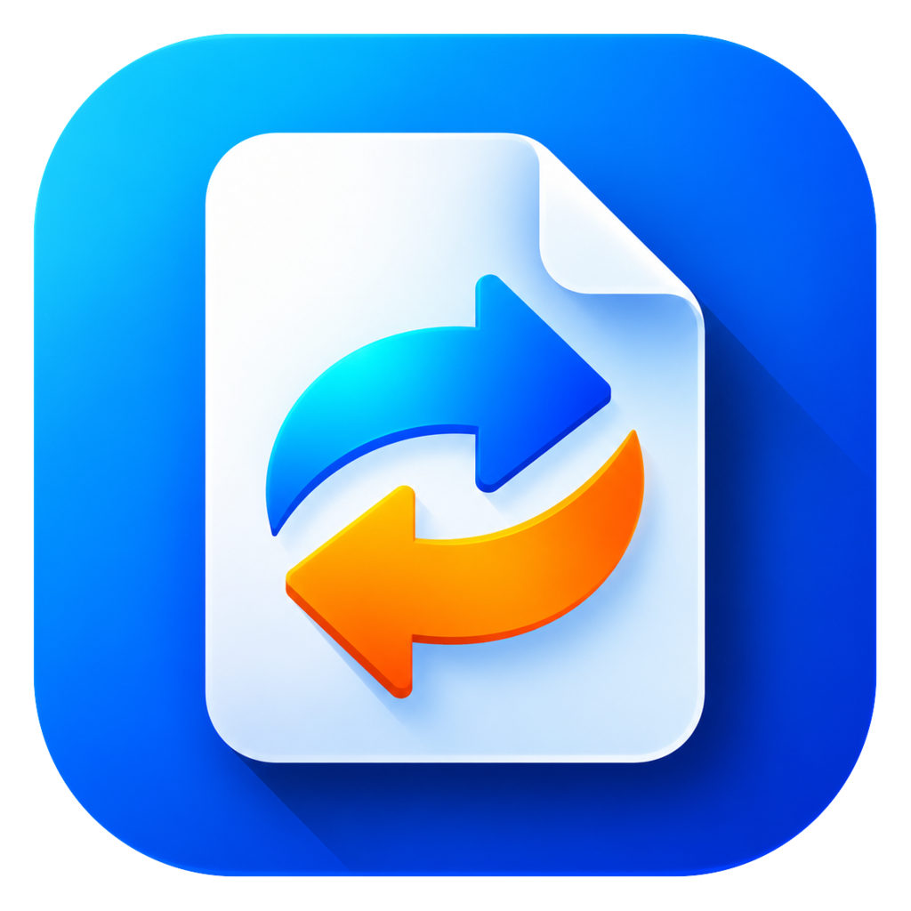

<p align="center"></p>

<h1 align="center">WinKame</h1>

<p align="center">
  <b>The zero-click file converter for Windows.</b><br>
  A <a href="https://morandi.cloud">morandi.cloud</a> product, created by <a href="https://github.com/thalesmorandi">Thales de Oliveira Morandi</a>.<br>
  <a href="https://winkame.morandi.cloud">winkame.morandi.cloud</a>
</p>

<p align="center">
  <a href="LICENSE"></a>
  
  
</p>

Zero-click file converter for Windows 10 and 11. Drag any file, tap a key, and drop it on a slice of the wheel:

| Key | Wheel |
| --- | --- |
| <kbd>Shift</kbd> | Convert formats |
| <kbd>Ctrl</kbd> | Tools (compress, crop, trim, split, PDF pages…) |
| <kbd>Alt</kbd> | File actions (copy, move, path, terminal, shelf, ZIP…) |
| <kbd>Space</kbd> | Your custom actions |

Everything runs offline on the PC. The interface is in English and Portuguese and follows the Windows language.

## Download

| | |
| --- | --- |
| **Installer** (recommended, no admin rights) | [WinKame-Setup-x64.exe](https://github.com/thalesmorandi/WinKame/releases/latest/download/WinKame-Setup-x64.exe) |
| Portable (unzip and run `WinKame.exe`) | [WinKame-Portable-x64.zip](https://github.com/thalesmorandi/WinKame/releases/latest/download/WinKame-Portable-x64.zip) |
| Checksums | [SHA256SUMS.txt](https://github.com/thalesmorandi/WinKame/releases/latest/download/SHA256SUMS.txt) |

Windows 10 (2004+) and 11, 64-bit. All versions are on the [Releases page](https://github.com/thalesmorandi/WinKame/releases).
How releases are built and signed: [Code signing policy](CODE_SIGNING_POLICY.md).

**Privacy:** WinKame will not transfer any information to other networked systems unless specifically requested by
the user. Details in the [Code signing policy](CODE_SIGNING_POLICY.md#privacy).

## Layout

```
src/WinKame.Core     Formats, conversion engines, settings, localization (no UI)
src/WinKame          WPF app: drag watcher, wheel, dialogs, tray, Explorer integration
tests/WinKame.Tests  xUnit tests
installer/           Inno Setup script (per-user install, no admin)
scripts/             fetch-ffmpeg.ps1, build-installer.ps1
```

## Build and run

Requires the .NET 9 SDK.

```powershell
.\scripts\fetch-ffmpeg.ps1          # downloads the bundled FFmpeg into src\WinKame\tools\ffmpeg (once)
dotnet build
dotnet test
dotnet run --project src\WinKame
```

Useful environment variables while developing:

- `WINKAME_HOME`: folder for settings and logs (keeps a dev copy apart from the installed one)
- `WINKAME_DEBUG=1`: writes `debug.log`
- `WINKAME_LANG=pt|en`: forces the interface language
- `WINKAME_NO_OFFICE=1`: never uses Microsoft Office for documents

Command line:

```powershell
WinKame.exe --convert file1.png file2.png --to webp
WinKame.exe --snapshot settings out.png             # renders a window to PNG off-screen
```

## Installer

Requires Inno Setup 6 (`winget install JRSoftware.InnoSetup`).

```powershell
.\scripts\build-installer.ps1       # -> artifacts\WinKame-Setup-<version>.exe
```

The version comes from `<Version>` in `src/WinKame/WinKame.csproj`.

Official releases are built and signed by GitHub Actions ([`release.yml`](.github/workflows/release.yml)) when a
`vX.Y.Z` tag is pushed; see the [Code signing policy](CODE_SIGNING_POLICY.md).

## Contributing

Issues and pull requests are welcome; please follow the [code of conduct](CODE_OF_CONDUCT.md). By sending a contribution you agree that it is published under the same license as the project (GPL-3.0-or-later). Please keep the copyright header at the top of each file.

## License

Copyright (C) 2026 Thales de Oliveira Morandi ([morandi.cloud](https://morandi.cloud)).

WinKame is free software under the [GNU General Public License v3.0 or later](LICENSE), with the additional terms in [`NOTICE`](NOTICE) (GPLv3 section 7): forks keep the author attribution, and use their own name and logo.

"WinKame" and the WinKame logo identify the official project. See [`TRADEMARKS.md`](TRADEMARKS.md) for what you can do with them.

The bundled FFmpeg build is GPLv3. Other third-party licenses are listed in [`THIRD-PARTY-NOTICES.txt`](THIRD-PARTY-NOTICES.txt).
